# LockScreen

[English](#english) · [Tiếng Việt](#tiếng-việt) · [繁體中文](#繁體中文)

## English

LockScreen covers your Windows desktop while you step away. Your session stays open. Press **Ctrl + Alt + K** to turn the screen black, then press a key or click to show the unlock prompt. You can use your password or Windows Hello if available.

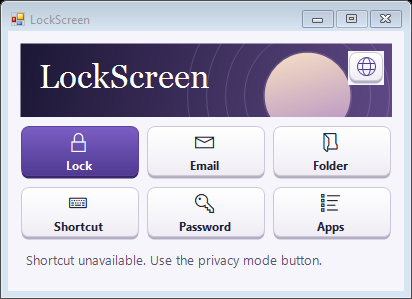

### Download and use

1. Download **LockScreen.exe** from this project and save it in the folder where you want to keep it.
2. Open the file. On first use, enter the same password twice (at least eight characters), then select **Lock**. LockScreen remembers the password for future sessions.

   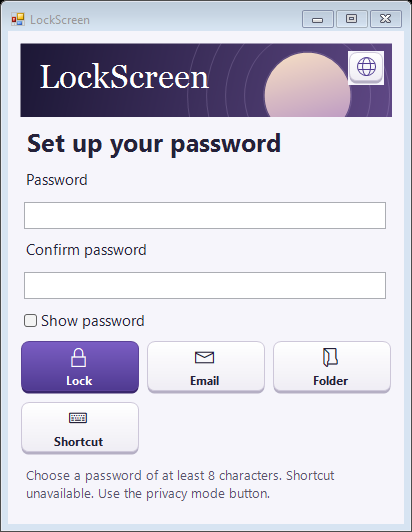

3. After unlocking, use the globe in the upper-right corner to change languages. **Shortcut** lets you set a different key combination and enable startup at Windows sign-in. A startup session runs in the system tray. Double-click its icon to open the window.
4. To update, quit the running copy from its tray menu and replace its executable in the same folder. If you move it, open **Shortcut** and save your startup preference again.

| Control | What it does |
|---|---|
| Lock | Covers the desktop and hides the running apps you selected. |
| Email | Configures the camera, photo folder and optional email delivery after an incorrect password. Use the test email button to check Gmail settings. |
| Folder | Opens the saved photos on this PC. |
| Shortcut | Changes the global shortcut and startup preference. |
| Password | Changes your password. **Forgot password?** offers a reset after successful Windows Hello verification. |
| Apps | Select app icons and choose **Save selection** for the next lock, or **Save and lock** to hide their windows immediately. |

### Protect selected apps

Select the apps you want to hide. Choose **Save selection** to remember them for the next lock, or **Save and lock** to hide their windows now.

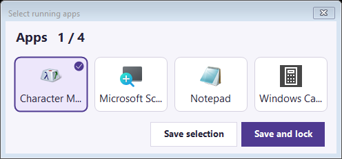

### Set up photo notifications

Open **Email**, choose the photo folder and enable email delivery if desired. The recipient shown below is an example. Send a test email before saving your Gmail settings.

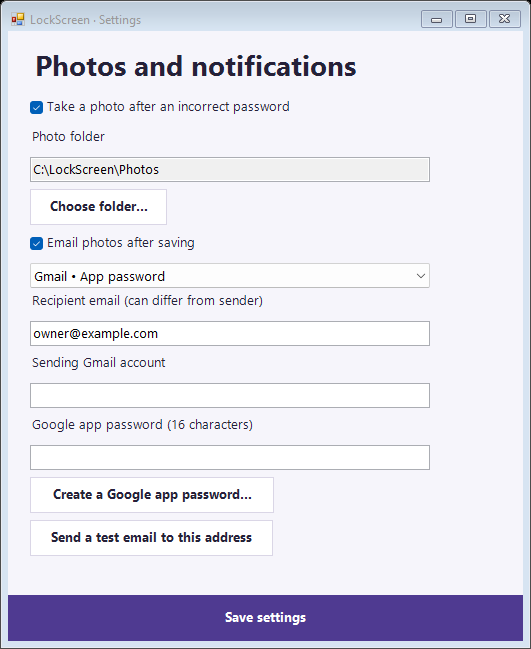

### Change or reset your password

Open **Password** to change it. If you forget the current password, use **Forgot password?** and complete Windows Hello verification.

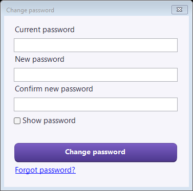

**Privacy limits.** Someone using the same Windows account can end LockScreen in Task Manager or access files directly. A protected window can briefly appear before it is hidden. LockScreen requests that Windows stay awake; continuous USB recording also depends on your recording software and device.

**Build from source:** On 64-bit Windows, install the **.NET Framework 4.8 Developer Pack** and a **Windows 10 or 11 SDK**. From the repository root, run `.\build.ps1` in PowerShell. The release executable is `bin\LockScreen.exe`.

## Tiếng Việt

LockScreen phủ đen màn hình khi bạn rời máy và giữ phiên Windows đang chạy. Nhấn **Ctrl + Alt + K** để khóa. Khi quay lại, bấm phím hoặc nhấp chuột rồi mở bằng mật khẩu hoặc Windows Hello nếu máy hỗ trợ.

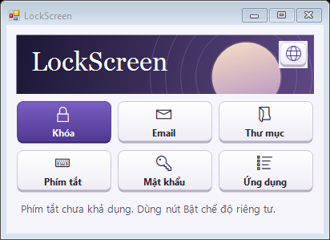

### Tải và sử dụng

1. Tải **LockScreen.exe** của dự án và lưu vào thư mục bạn muốn dùng lâu dài.
2. Mở tệp. Lần đầu, nhập mật khẩu hai lần giống nhau (ít nhất tám ký tự) rồi bấm **Khóa**. Ứng dụng ghi nhớ mật khẩu cho lần sau.

   

3. Sau khi mở khóa, bấm biểu tượng địa cầu ở góc trên phải để đổi ngôn ngữ. Vào **Phím tắt** để đổi tổ hợp phím hoặc bật chạy khi đăng nhập Windows. Nếu đã bật tự khởi động, nhấp đúp biểu tượng LockScreen ở khay hệ thống để mở cửa sổ.
4. Khi cập nhật, thoát bản đang chạy từ khay hệ thống rồi thay tệp mới tại cùng vị trí. Nếu chuyển tệp sang thư mục khác, mở **Phím tắt** và lưu lại lựa chọn khởi động.

| Nút | Công dụng |
|---|---|
| Khóa | Phủ đen màn hình và ẩn những ứng dụng đang chạy mà bạn đã chọn. |
| Email | Bật chụp ảnh khi nhập sai, thư mục lưu và cách gửi email. Dùng nút gửi thư thử để kiểm tra Gmail. |
| Thư mục | Mở thư mục ảnh đã lưu trên máy. |
| Phím tắt | Đổi tổ hợp phím và cài đặt khởi động cùng Windows. |
| Mật khẩu | Đổi mật khẩu. Nếu quên, chọn **Quên mật khẩu?** và xác minh bằng Windows Hello để đặt lại. |
| Ứng dụng | Bấm biểu tượng để chọn. **Lưu lựa chọn** áp dụng cho lần khóa sau; **Lưu và khóa** ẩn các cửa sổ đã chọn ngay. |

### Chọn ứng dụng cần khóa

Bấm vào thẻ ứng dụng muốn ẩn. Chọn **Lưu lựa chọn** để áp dụng khi khóa màn hình lần sau, hoặc **Lưu và khóa** để ẩn cửa sổ ngay.

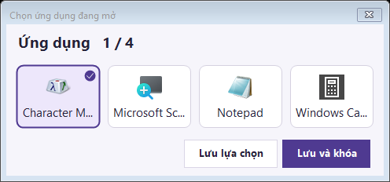

### Cài đặt ảnh và thông báo email

Mở **Email** để chọn thư mục lưu ảnh và bật gửi email nếu cần. Địa chỉ nhận trong ảnh là ví dụ. Với Gmail, bấm **Gửi thư thử đến địa chỉ trên** để kiểm tra trước khi lưu.

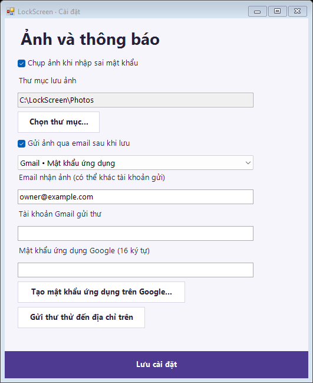

### Đổi mật khẩu hoặc khôi phục quyền truy cập

Mở **Mật khẩu** để đổi mật khẩu. Nếu quên mật khẩu hiện tại, bấm **Quên mật khẩu?** rồi xác minh bằng Windows Hello.

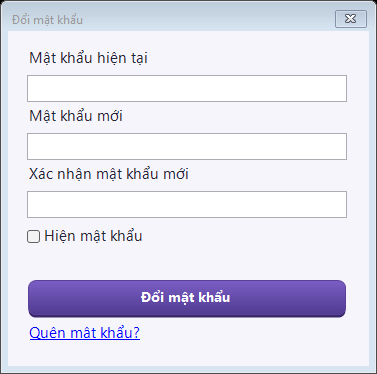

**Giới hạn bảo vệ.** Người dùng chung tài khoản Windows vẫn có thể kết thúc LockScreen bằng Task Manager hoặc đọc tệp trực tiếp. Cửa sổ được bảo vệ có thể lóe lên trước khi bị ẩn. Ứng dụng yêu cầu Windows giữ máy thức; việc thu dữ liệu USB liên tục còn phụ thuộc vào phần mềm và thiết bị thu.

**Tự biên dịch:** Trên Windows 64-bit, cài **.NET Framework 4.8 Developer Pack** và **Windows 10 hoặc 11 SDK**. Mở PowerShell tại thư mục gốc của kho, chạy `.\build.ps1`. Tệp kết quả nằm tại `bin\LockScreen.exe`.

## 繁體中文

離開座位時，可用 LockScreen 將螢幕畫面遮黑，同時保留目前的 Windows 工作階段。按 **Ctrl + Alt + K** 即可鎖定。回來後按任一鍵或點一下滑鼠，再輸入密碼；裝置支援 Windows Hello 時，也可以使用 Windows Hello 解鎖。

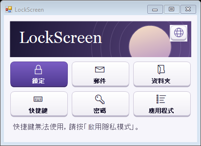

### 下載與使用

1. 下載本專案提供的 **LockScreen.exe**，並將檔案放在日後固定使用的資料夾。
2. 開啟程式。第一次使用時，輸入兩次相同的密碼（至少八個字元），再按 **鎖定**。程式會記住密碼供下次使用。

   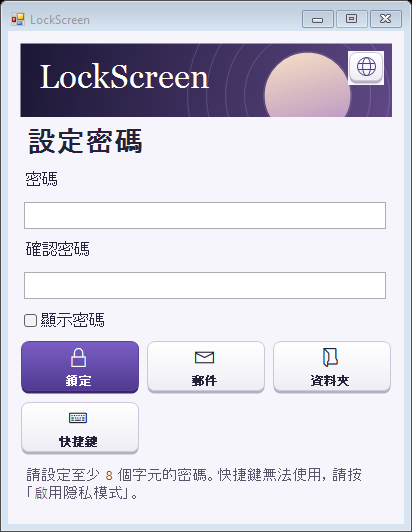

3. 解鎖後，點選右上角的地球圖示即可切換語言。在 **快捷鍵** 中可以更改按鍵組合，或設定登入 Windows 時自動執行。自動啟動時程式會留在系統匣，按兩下圖示即可開啟視窗。
4. 更新時，先從系統匣結束舊版，再以新版執行檔取代原位置的檔案。若移動執行檔，請開啟 **快捷鍵** 並重新儲存啟動設定。

| 按鈕 | 用途 |
|---|---|
| 鎖定 | 遮黑桌面，並隱藏已選取且正在執行的應用程式視窗。 |
| 郵件 | 設定輸入錯誤密碼時是否拍照、照片資料夾及寄信方式。可寄送測試郵件來確認 Gmail 設定。 |
| 資料夾 | 開啟本機儲存照片的資料夾。 |
| 快捷鍵 | 更改全域快捷鍵，以及登入時的啟動設定。 |
| 密碼 | 變更密碼。忘記密碼時，點選 **忘記密碼？**，通過 Windows Hello 驗證後即可重設。 |
| 應用程式 | 點選圖示後，選 **儲存選取項目** 供下次鎖定使用，或選 **儲存並鎖定** 立即隱藏視窗。 |

### 選擇要鎖定的應用程式

點選要隱藏的應用程式圖示，再選 **儲存選取項目**，供下次鎖定時使用。若要立即隱藏視窗，請選 **儲存並鎖定**。

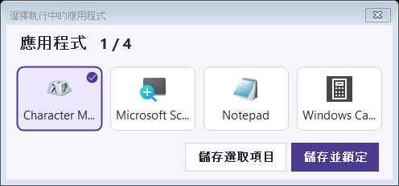

### 設定照片與電子郵件通知

開啟 **郵件**，選擇照片資料夾，並視需要啟用寄信功能。下圖的收件地址僅為範例。使用 Gmail 時，可先寄送測試郵件，再儲存設定。

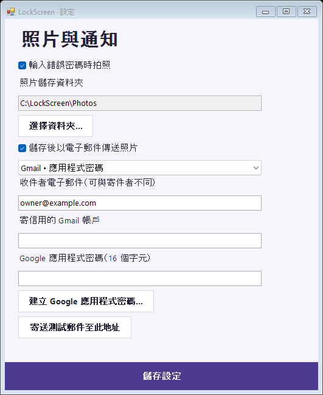

### 變更或重設密碼

開啟 **密碼** 即可變更密碼。若忘記目前密碼，請點選 **忘記密碼？** 並完成 Windows Hello 驗證。

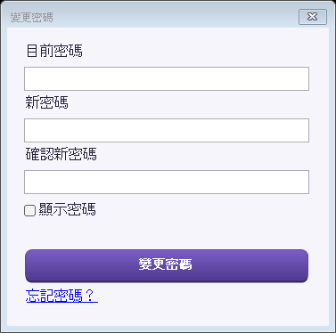

**保護範圍：** 使用相同 Windows 帳戶的人仍可從工作管理員結束 LockScreen，或直接開啟檔案。受保護的視窗在隱藏前可能短暫出現。程式會要求 Windows 保持喚醒，USB 資料能否持續記錄仍取決於擷取軟體及裝置。

**從原始碼編譯：** 在 64 位元 Windows 安裝 **.NET Framework 4.8 Developer Pack** 和 **Windows 10 或 11 SDK**。在儲存庫根目錄開啟 PowerShell，執行 `.\build.ps1`。編譯完成後，執行檔位於 `bin\LockScreen.exe`。

